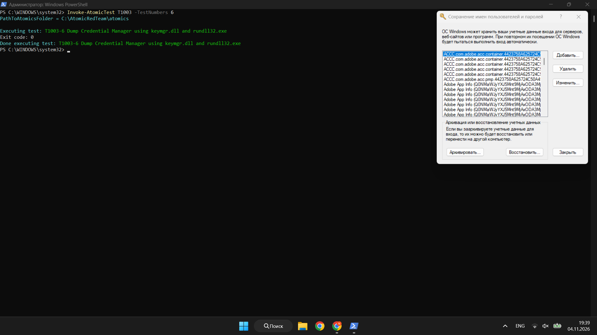
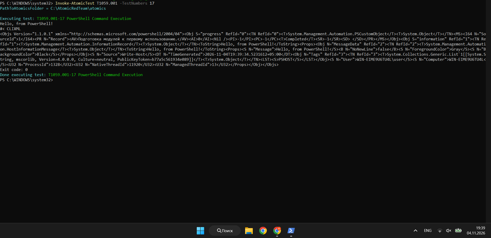
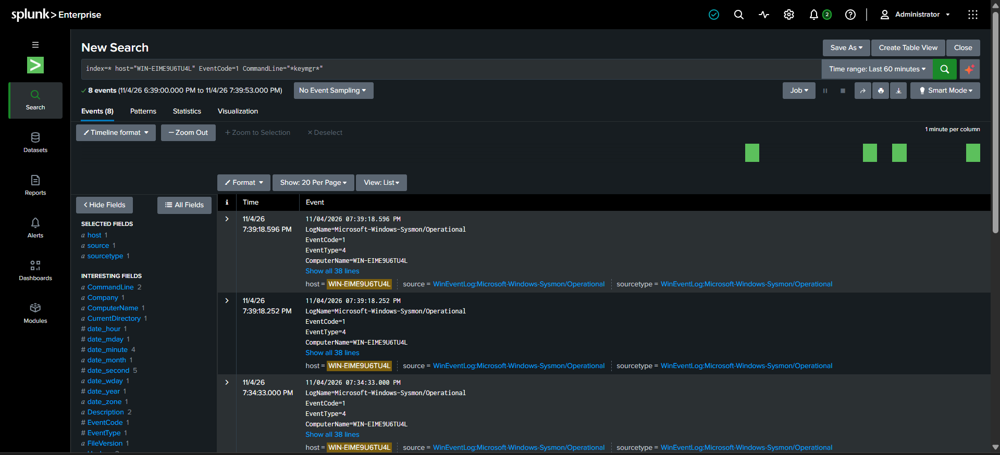
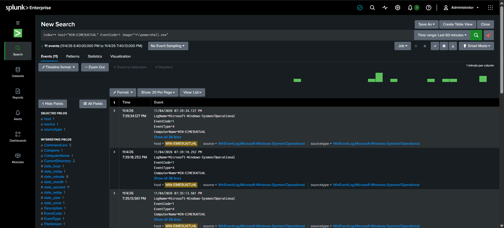

# Week 9: Atomic Red Team Testing & Splunk SIEM Analysis

## Objective
Run selected Atomic Red Team tests (T1003 and T1059.001) on a Windows lab VM and analyze detection results in Splunk to identify coverage and detection gaps.

## Environment
- **Endpoint:** Windows VM (Hostname: `WIN-EIME9U6TU4L`)
- **SIEM:** Splunk Enterprise (with Universal Forwarder)
- **Logging:** Sysmon (EventCode 1 - Process Creation)
- **Tooling:** Invoke-AtomicRedTeam (`C:\AtomicRedTeam\`)

## Tests Executed

### 1. T1003 – OS Credential Dumping
- **Test:** T1003-6 (Dump Credential Manager using keymgr.dll and rundll32.exe)
- **Command:** `Invoke-AtomicTest T1003 -TestNumbers 6`
- **Result:** Executed successfully (Exit code: 0). The Windows Credential Manager window was successfully invoked on the endpoint, proving the execution of the technique.

**Proof of Execution (PowerShell):**

### 2. T1059.001 – Command and Scripting Interpreter: PowerShell
- **Test:** T1059.001-4 (Mimikatz - Cradlecraft PsSendKeys)
- **Result:** Blocked by Windows Defender ("Access Denied"). *Note: This confirms endpoint protection is active.*
- **Test:** T1059.001-17 (PowerShell Command Execution)
- **Command:** `Invoke-AtomicTest T1059.001 -TestNumbers 17`
- **Result:** Executed successfully. The test triggered a PowerShell execution with an encoded command (`-e`), which was captured by Sysmon.

**Proof of Execution (PowerShell):**

## Splunk Analysis

### T1003 Analysis
- **Search used:** `index=* host="WIN-EIME9U6TU4L" EventCode=1 CommandLine="*keymgr*"`
- **Findings:** Splunk successfully captured the execution. The logs show `powershell.exe` spawning `rundll32.exe` with the malicious arguments (`keymgr`, `KRShowKeyMgr`).
- **Alerting:** No automated alert or correlation rule triggered in Splunk. It was only visible via manual search.

**Splunk Search Results for T1003:**

### T1059.001 Analysis
- **Search used:** `index=* host="WIN-EIME9U6TU4L" EventCode=1 Image="*\\powershell.exe"`
- **Findings:** Sysmon successfully logged the PowerShell execution. The logs reveal a suspicious command line: `powershell.exe -e JgAgAcgAZwB...` (where `-e` stands for `-EncodedCommand`). This is a common technique used by attackers to obfuscate malicious scripts.
- **Alerting:** No automated alert triggered for the encoded PowerShell command. This is a critical detection gap, as this behavior is heavily associated with malware.

**Splunk Search Results for T1059:**

## References
- Atomic Red Team Wiki & GitHub Repository
- MITRE ATT&CK T1003: https://attack.mitre.org/techniques/T1003/
- MITRE ATT&CK T1059.001: https://attack.mitre.org/techniques/T1059/001/

---
## AI Usage Disclosure

I used an AI assistant (ChatGPT) to help me with this week's task. The AI helped me in the following ways:
- It helped me understand how to install and set up the Atomic Red Team tools when I had errors in PowerShell.
- It helped me fix the script execution policy error.
- It gave me ideas for Splunk search queries to find the test events.
- It helped me write this report in clear English and structure the document.

I did all the practical work by myself. I ran the commands in the virtual machine, I took the screenshots, and I checked the logs in Splunk. The AI was only a helper for learning and structuring the final text.
