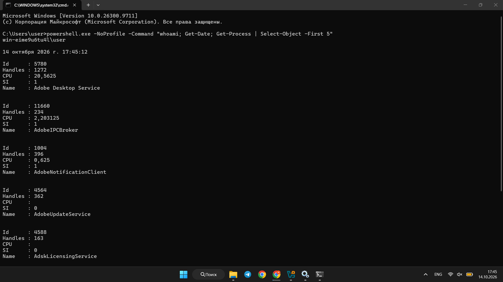
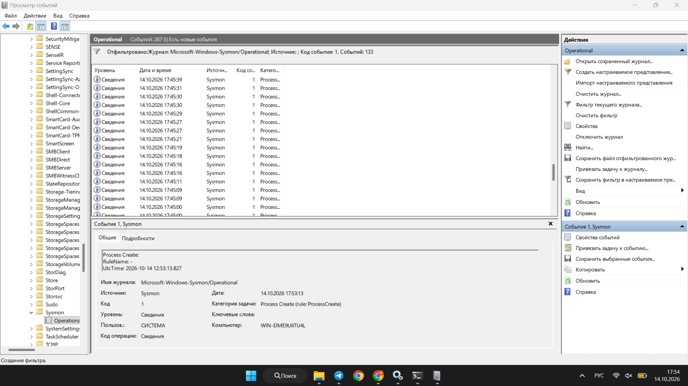
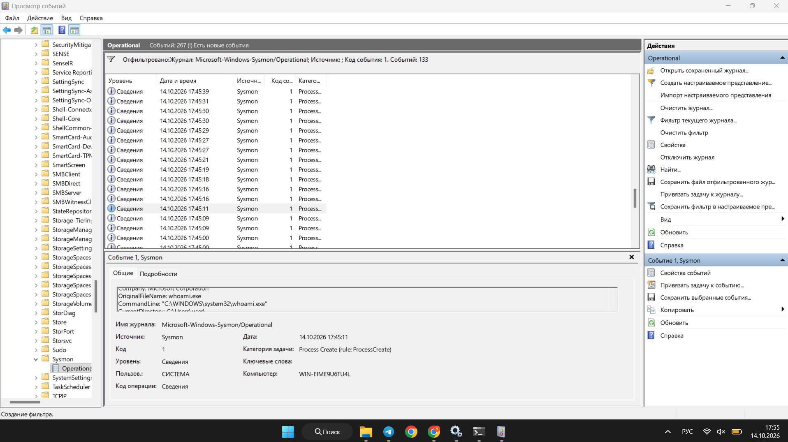
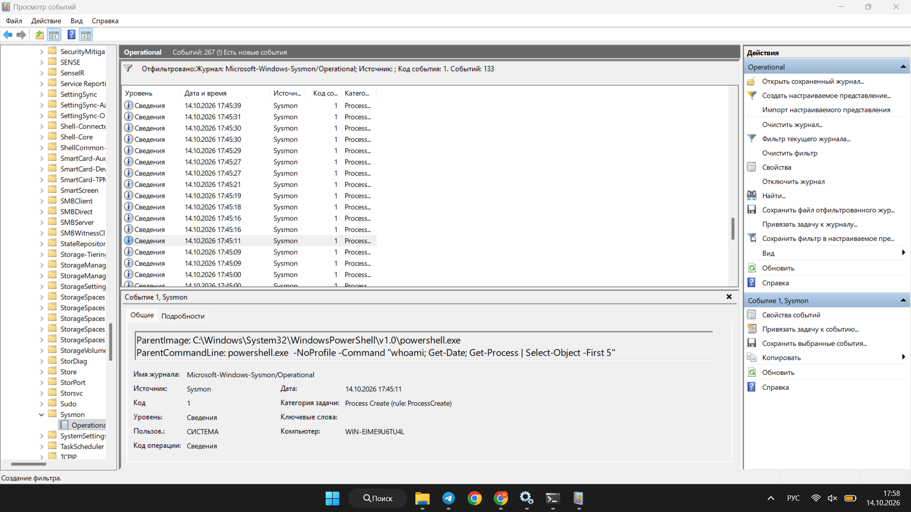

# Week 6 — MITRE ATT&CK: PowerShell Execution (T1059.001)

## Objective
Study one MITRE ATT&CK technique, simulate related activity in a local test environment, examine the system logs, and map the observations to ATT&CK tactics and techniques.

## Technique Overview
**T1059.001 — Command and Scripting Interpreter: PowerShell** is a MITRE ATT&CK sub-technique. Attackers can use PowerShell to execute commands and scripts on Windows systems. PowerShell is also a normal administration tool, so its use alone does not prove malicious activity.

Reference: https://attack.mitre.org/techniques/T1059/001/

## Environment
- Windows 11
- Windows Command Prompt (CMD)
- Windows PowerShell
- Microsoft Sysmon v15.22
- Windows Event Viewer

## Simulation Steps
1. Downloaded Sysmon from the official Microsoft Sysinternals website and extracted it to `C:\Sysmon`.
2. Installed Sysmon from an administrator PowerShell window:
   ```powershell
   cd C:\Sysmon
   .\Sysmon64.exe -accepteula -i
   Get-Service Sysmon64
   ```
3. Confirmed that the Sysmon64 service status was `Running`.
4. Opened CMD and executed this harmless test command:
   ```cmd
   powershell.exe -NoProfile -Command "whoami; Get-Date; Get-Process | Select-Object -First 5"
   ```
5. Opened Event Viewer at `Applications and Services Logs > Microsoft > Windows > Sysmon > Operational`.
6. Filtered the log by **Event ID 1 (Process Create)** and inspected events around the test time.
7. Found a `whoami.exe` process creation event with PowerShell as its parent process.

## Observed Results
- The CMD screenshot shows the test command ran and printed the current user, date, and a list of processes.
- Sysmon recorded **Event ID 1** at **2026-10-14 17:45:11 local time** for `C:\Windows\System32\whoami.exe`.
- The event's `ParentImage` was `C:\Windows\System32\WindowsPowerShell\v1.0\powershell.exe`.
- The `ParentCommandLine` matched the PowerShell test command:
  ```text
  powershell.exe -NoProfile -Command "whoami; Get-Date; Get-Process | Select-Object -First 5"
  ```
- This confirms that PowerShell launched `whoami.exe` during the local simulation. It does **not** show a real attack or prove that the activity was malicious.

## Evidence

### PowerShell command executed in CMD


### Sysmon process creation events


### Sysmon event for whoami.exe


### Parent process and command line


## MITRE ATT&CK Mapping

| Category | Description |
|---|---|
| Tactic | Execution (TA0002) |
| Technique | Command and Scripting Interpreter (T1059) |
| Sub-technique | PowerShell (T1059.001) |
| Data Source | Sysmon Event ID 1 |
| Observed Activity | PowerShell launched whoami.exe |
| Result | Successful simulation |

## Conclusion
In this lab, I studied MITRE ATT&CK technique T1059.001 and simulated PowerShell command execution on Windows. I used Sysmon and Event Viewer to check the activity. Sysmon Event ID 1 showed that PowerShell started the `whoami.exe` process. This helped me understand how process logs can support threat detection. The commands were safe test commands, not a real cyberattack.

## Limitations and Next Steps
The evidence confirms one child process and its PowerShell parent. A separate Sysmon event for the initial PowerShell process was not captured in the submitted screenshots. In Week 7, a CAR analytic should be selected and implemented in a SIEM using real imported events; this has not yet been done.
