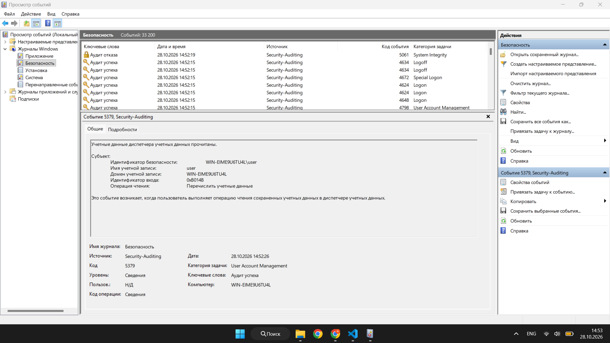
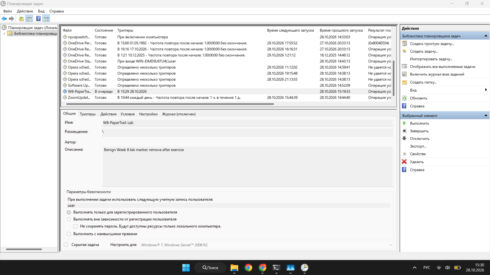
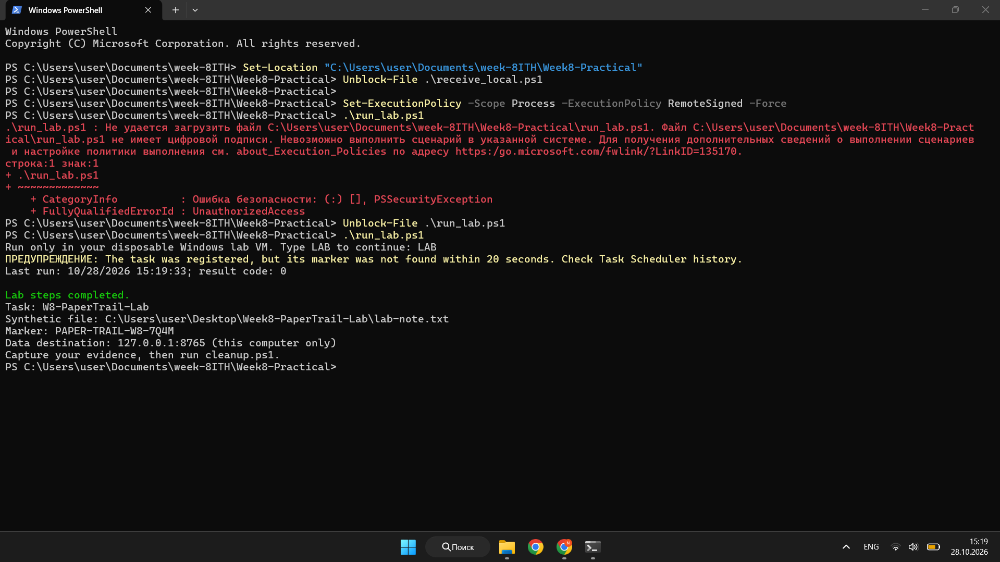
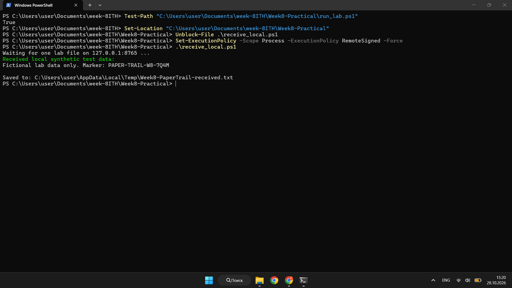

# Week 8 — Operation Paper Trail

- **Topic:** Adversary emulation plan with MITRE ATT&CK
- **Date:** 28 October 2026
- **Platform:** Windows 11 lab computer
- **Status:** The plan is complete. A local test was run. CALDERA and Splunk were not used.

## 1. Goal

This work presents a simple plan with three stages: initial access, persistence, and data exfiltration. Each stage is linked to a MITRE ATT&CK technique.

The plan is for a computer that I own or have permission to test. It uses a test account and fictional data. It does not use real passwords, personal files, malware, or an outside destination.

## 2. Scenario

A test user signs in to a Windows lab computer. A scheduled task is created as a persistence test. Then a small text file with fake data is sent to a receiver on the same computer. A defender checks Windows and Sysmon logs in Splunk.

The file has a unique marker: `PAPER-TRAIL-W8-7Q4M`. This marker helps the defender find the test data. It is not a password or a tracking link.

## 3. Safety Rules

- Use a lab computer or virtual machine that you own or can test.
- Use only a test account and fake data.
- Send the file only to `127.0.0.1`, which means the same computer.
- Do not use public servers, cloud storage, or personal data.
- Remove the test task and files after the test.

## 4. Plan and MITRE ATT&CK Mapping

| Order | Stage | ATT&CK technique | Planned action | Evidence to check |
|---|---|---|---|---|
| 1 | Initial access | [Valid Accounts — T1078](https://attack.mitre.org/techniques/T1078/) | Sign in with a test account made for the lab. | Windows Security Event ID 4624 and the sign-in time. |
| 2 | Persistence | [Scheduled Task — T1053.005](https://attack.mitre.org/techniques/T1053/005/) | Create a named task that runs a harmless marker action. Do not hide it or run a downloaded program. | Task Scheduler history, Windows Security Event ID 4698 if enabled, and Sysmon Event ID 1 if recorded. |
| 3 | Data exfiltration | [Exfiltration Over C2 Channel — T1041](https://attack.mitre.org/techniques/T1041/) | In the planned CALDERA test, send only the fake file through the same lab channel to a local receiver. | CALDERA record, Sysmon Event ID 3 if enabled, and the receiver log. |

The plan uses CALDERA to organize the test stages. The exact CALDERA abilities depend on the plugins installed in the lab. Each ability should be checked before use.

## 5. Local Test Results

I ran a small PowerShell test. It was a local demonstration, not a CALDERA operation.

### Windows logon

The Windows Security log shows Event ID 4624 at **28 October 2026, 14:52:15**. The screenshot does not show the details for this event, so the account name and logon type are not confirmed. The selected event is ID 5379 at 14:52:26; it records a read from Credential Manager.

### Scheduled task

The task `W8-PaperTrail-Lab` was created. PowerShell showed it in state `Queued`. It showed a last run time of **14:59:17** and result code `0`. A later check did not find the expected marker file. A second run also did not find it within 20 seconds.

The Task Scheduler screenshot shows the task under the `user` account. Its state is `Queued`. Task history is disabled in the screenshot. This confirms that the task was created, but it does not confirm that the task action completed.

### Local file transfer

The PowerShell script sent the fake file `lab-note.txt` to `127.0.0.1:8765`. The receiver showed the marker `PAPER-TRAIL-W8-7Q4M` and saved the file in the user's Temp folder.

This local transfer is not a real C2 transfer. It does not prove that technique T1041 was performed. No Sysmon network event or Splunk result is shown in the evidence.

## 6. Defender Review Plan

In a full lab test, the defender would check the events around the test time:

1. Windows Security Event ID 4624 for the test sign-in.
2. Task Scheduler history or Event ID 4698 for task creation, if enabled.
3. Sysmon Event ID 1 for a process started by the task, if recorded.
4. Sysmon Event ID 3 and the receiver log for the local file transfer, if network logging is enabled.

The defender should compare the account, computer, time, task name, process, and destination. One event alone does not prove an attack.

## 7. Limits

- CALDERA was not run.
- Splunk was not used to search the events.
- The task was created, but its marker action was not confirmed.
- The file transfer stayed on the same computer. It was not a real C2 transfer.
- Windows settings affect which events are saved.

## 8. Conclusion

This work provides a three-stage plan with ATT&CK techniques T1078, T1053.005, and T1041. The local test confirmed that a fake file with a unique marker reached a receiver on the same computer. It also confirmed that the scheduled task was created, but not that its action completed. CALDERA and Splunk results are not claimed.

## 9. AI Use

ChatGPT helped me prepare the plan, the local test scripts, and this report. I ran the local test and took the screenshots. I did not run CALDERA or search the results in Splunk.

## References

- MITRE ATT&CK, [Valid Accounts (T1078)](https://attack.mitre.org/techniques/T1078/)
- MITRE ATT&CK, [Scheduled Task (T1053.005)](https://attack.mitre.org/techniques/T1053/005/)
- MITRE ATT&CK, [Exfiltration Over C2 Channel (T1041)](https://attack.mitre.org/techniques/T1041/)
- MITRE CALDERA, [Documentation](https://caldera.readthedocs.io/en/stable/)
- [Local practical runbook](Week8-Practical/README.md)
